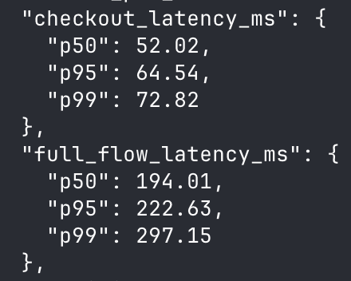

# Checkout and Rewards Service

A Python 3.12, FastAPI, and PostgreSQL service for atomic checkout, milestone coupons, and reconciled reporting. The code is a [modular monolith](MODULES.md) with separate routes, services, repositories, models, and migrations.


## Run the API

Docker Compose is the only runtime prerequisite. It starts PostgreSQL, applies migrations, seeds five products and the reward policy, and runs two API workers.

```sh
docker compose up --build -d api
```
```sh
curl http://localhost:8000/products
```

The OpenAPI docs is at [localhost:8000/docs](http://localhost:8000/docs).
## Show the scenarios

The demo uses its own `checkout_demo` database and resets only that database each time.
```sh
docker compose --profile demo run --build --rm demo
```

## Test and inspect

The integration tests use a separate `checkout_test` database and real PostgreSQL transactions.

```sh
docker compose --profile test run --build --rm tests
```

Lint and code formating:
```sh
uv sync
uv run ruff check .
uv run ruff format --check .
uv lock --check
```

## load testing on the API

The load command uses a dedicated `checkout_load` database. Each run resets that database, starts **two real API worker processes**, and sends HTTP requests through concurrent clients.
```sh
docker compose --profile load run --build --rm load
LOAD_ORDERS=500 LOAD_CLIENTS=32 docker compose --profile load run --build --rm load
```
Results of above load test with 500 orders and 32 clients:


### What I will do if I get 1-2 more hours:
- run load test with EXPLAIN(ANALYSE, BUFFERS) and find out bottlenecks in SQL queries
- examine other performance bottlenecks(missing index, DB pool exhaustion) and fix the same


> Note: The major choices, limits, and scale path are explained in [DECISIONS.md](DECISIONS.md).
