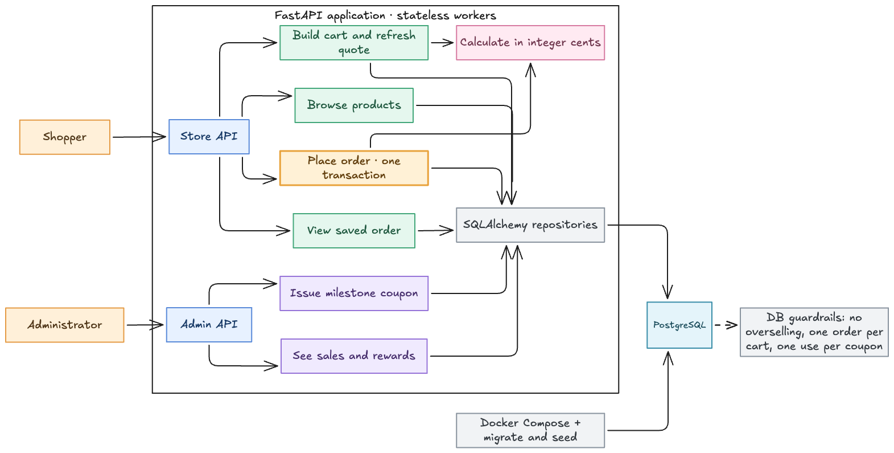

# Checkout and Rewards Service

A Python API for the reliable checkout assignment. The design is a modular monolith backed by PostgreSQL. Work is being delivered [one module at a time](MODULES.md).

## High-level design



## Current scope: module 1

The runnable service currently exposes a seeded product catalog and health endpoints. Carts, checkout, rewards, and reporting are the next modules; their routes are not present yet.

### Run locally with Docker Compose

Docker Compose is the only runtime prerequisite. It starts PostgreSQL, applies migrations, seeds five products, and runs the API with two worker processes:

```sh
docker compose up --build -d api
curl http://localhost:8000/products
```

Open [the generated API documentation](http://localhost:8000/docs) to inspect the endpoints. `GET /health/live` checks the process; `GET /health/ready` checks database connectivity. The seed is repeatable and does not reset inventory in an existing database.

### Run tests and code-quality checks

The test service uses its own `checkout_test` database in the same local PostgreSQL container. Its database is created when the Compose volume is first initialized.

```sh
docker compose --profile test run --build --rm tests
uv sync
uv run ruff check .
uv run ruff format --check .
```

The `uv.lock` file pins Python dependencies. To stop containers, run `docker compose down`. To **erase local database data** and recreate both databases from scratch, run `docker compose down -v`.

## Module 1 API

| Endpoint | Response |
| --- | --- |
| `GET /products` | `200` with product IDs, names, prices in cents, and available inventory |
| `GET /health/live` | `200` when the API process is running |
| `GET /health/ready` | `200` when PostgreSQL is reachable |

Product 5 has one unit of inventory for the later concurrency demonstration. Prices are integer cents; the intended currency is USD.
